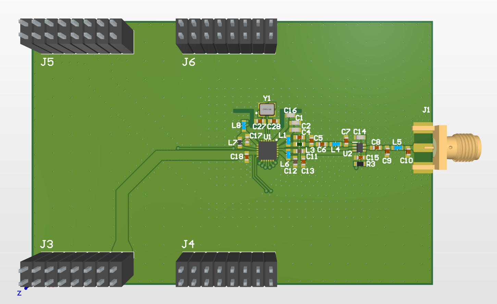

# Remote-Weather-Station

> ### State of the project: designing the PCB

The purpose of this device is to monitor the temperature of a lake and transmit the data over several kilometers using LoRa.

The design schematic and PCB files can be found [here](https://github.com/k3idi/Remote-Weather-Station/tree/main/PCB%20design%20files).

MCU and power             |  LoRa
:-------------------------:|:-------------------------:
  |  

